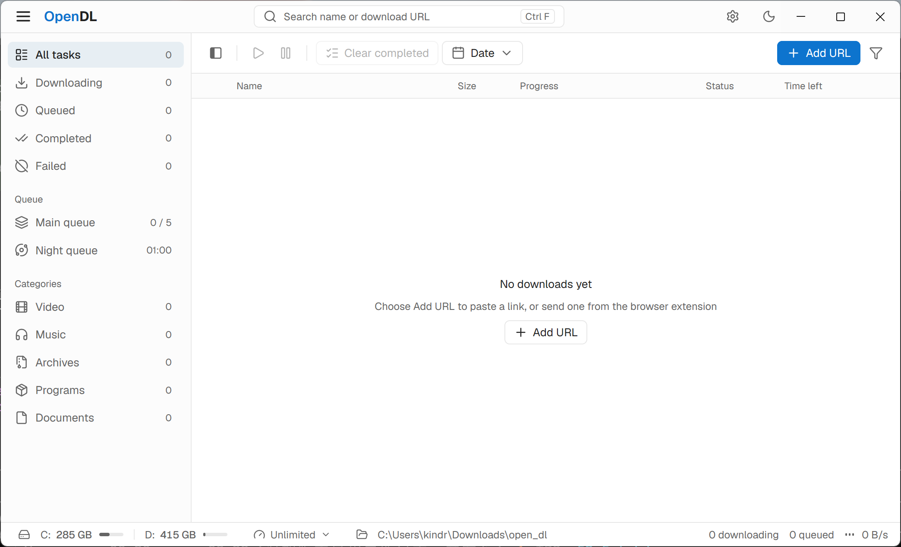

<div align="center">


# OpenDL

**A desktop download manager with a clean interface and a full set of features.**

Manage downloads in one place, discover links and media through browser extensions, and organize downloads with queues and schedules.

[](LICENSE)
[](https://go.dev/)
[](https://github.com/kindred-7/openDL/releases)
[](https://github.com/kindred-7/openDL/releases)

[Download](https://github.com/kindred-7/openDL/releases) · [Report an issue](https://github.com/kindred-7/openDL/issues) · [Privacy policy](privacy/privacy.md) · [Changelog](https://github.com/kindred-7/openDL/releases)

[简体中文](README.md) | **English**

</div>

---

## Introduction

OpenDL is a desktop download manager for everyday use. It brings downloads together with multi-connection acceleration, resume support, queues and scheduling. Browser extensions can send downloadable links and media from web pages directly to the desktop app.

Paste a URL or capture a resource from your browser to keep downloads organized and visible.

## Screenshot

<div align="center">



</div>

## Features

- **Download management** — Add links, pause and resume downloads, view progress, speed and task details, and import or export task lists.
- **Multiple connections and resume** — Download in segments when the server supports it and resume interrupted tasks when possible. The automatic connection count adjusts to throughput gains, up to 64 connections.
- **Queues and schedules** — Use the main queue, night queue or custom queues, each with its own concurrency, speed limit and operating hours.
- **Browser integration** — Discover and send links and audio or video resources through the extension, context menu or download interception.
- **Media downloads** — Download supported HLS and DASH streams with a choice of quality and audio track; some merging operations require FFmpeg.
- **Personalization** — Customize download locations, classification rules, themes, notifications, proxies and shortcuts.

> Resource detection, resume and media downloads depend on the website, server and resource format. DRM decryption is not supported.

## Installation

### Desktop app

Currently, only Windows releases are available; macOS and Linux installers are not provided. Download the Windows installer from [Releases](https://github.com/kindred-7/openDL/releases). After installation, launch OpenDL and choose a download directory in settings. The app registers the browser native messaging host for the current user on startup.

**Building from source** (Windows installer) requires Go and Inno Setup 6.6 or later:

```powershell
./scripts/install-mygo-installer-adapter.ps1   # Install the build adapter on first use
go tool mygo build                             # Build the app
```

The installer is written to `build/windows-<architecture>/OpenDL Setup <version> <architecture>.exe`. If a running development instance is using the build directory, use `./scripts/build-windows-installer.ps1` instead; it builds in a temporary directory to avoid conflicts. For ARM64, add `-Architecture arm64`.

### Browser extension

**Chrome / Microsoft Edge** — Store submissions are under review. Until the extension is available in the stores, load it manually:

1. Launch OpenDL and open the browser extension installation instructions from the app menu.
2. Open the browser's extension management page and enable developer mode.
3. Choose “Load unpacked” and select the `extension` folder in the installation directory.
4. Open a regular web page, click the extension icon and confirm that it is connected.

**Firefox** — Install `extension/OpenDL-firefox.xpi` from the installation directory through the extension management page. This package is signed by Mozilla. Desktop app updates do not automatically update the Firefox extension; replace it manually with the new signed package.

## Quick start

**Add a download** — Create a new download, paste the URL, choose a save location and start it.

**Send from a browser** — Open a page and select a resource from the extension, or right-click a link, audio or video and choose to download with OpenDL. With download interception enabled, recognized file links are sent to OpenDL before the browser starts downloading them.

**Arrange queues** — Choose a queue when adding a task or from the task management view, and set concurrency, speed limits and scheduled hours as needed.

## FAQ

<details>
<summary><b>The extension says it is disconnected</b></summary>
<br />

Start the desktop app and make sure the app and extension versions are compatible. Then reopen the extension and check the installation instructions.

</details>

<details>
<summary><b>A resource on a page does not appear</b></summary>
<br />

Resources on dynamic or browser-restricted pages, in cross-origin frames or on some sites may not be detected. Copy the download URL and add it manually in the desktop app.

</details>

<details>
<summary><b>A download cannot be resumed</b></summary>
<br />

Resume support depends on the server, the validity of the URL and whether the resource has changed. If the conditions are not met, you may need to update the URL or download the file again.

</details>

<details>
<summary><b>Media cannot be merged</b></summary>
<br />

Some tasks require FFmpeg to be installed locally and its path configured in OpenDL settings. Results depend on the media format and resource state.

</details>

## Documentation and feedback

- [Extension privacy policy](privacy/privacy.md) — The data handled by the extension and its purposes (in Chinese).
- [Report an issue](https://github.com/kindred-7/openDL/issues) — Include your operating system, browser version, steps and actual results. Do not post passwords, cookies or links containing private tokens.

## License

This project is open source under the [MIT License](LICENSE). Third-party assets and dependencies are subject to their respective licenses.
