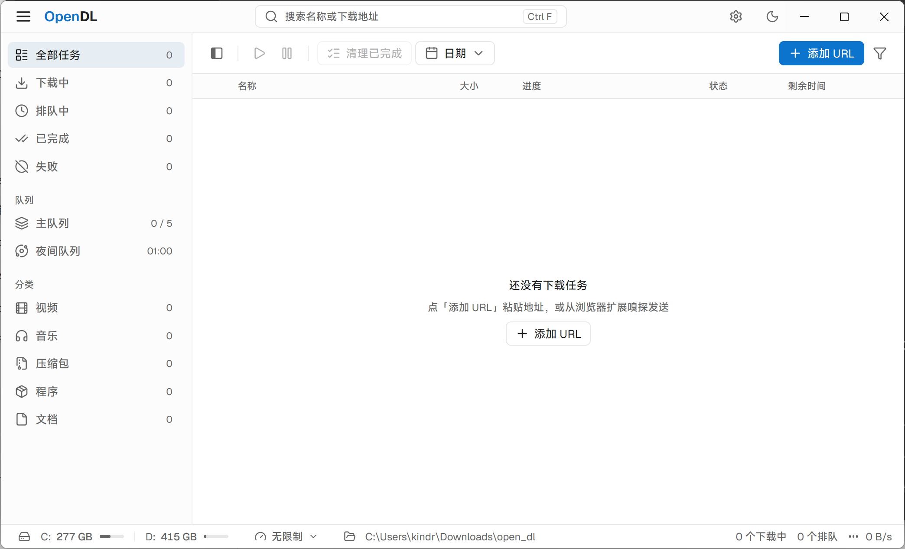

<div align="center">


# OpenDL

**一款界面简洁、功能完整的桌面下载管理器。**

集中管理下载任务，通过浏览器扩展发现网页中的链接与媒体资源，按队列与计划安排下载。

[](LICENSE)
[](https://go.dev/)
[](https://github.com/kindred-7/openDL/releases)
[](https://github.com/kindred-7/openDL/releases)

[下载](https://github.com/kindred-7/openDL/releases) · [问题反馈](https://github.com/kindred-7/openDL/issues) · [隐私政策](privacy/privacy.md) · [更新日志](https://github.com/kindred-7/openDL/releases)

**简体中文** | [English](README.en.md)

</div>

---

## 简介

OpenDL 是一款面向日常使用的桌面下载管理器。它将下载任务集中到一处，提供多连接加速、断点续传、队列与计划调度，并借助浏览器扩展把网页中的可下载链接和媒体资源直接发送到桌面应用。

无论你是粘贴地址手动下载，还是从浏览器一键抓取资源，OpenDL 都让下载变得可控、可见、可安排。

## 截图

<div align="center">



</div>

## 特性

- **下载管理** — 添加链接、暂停与继续、查看进度与速度、任务详情，支持任务列表的导入导出。
- **多连接与续传** — 服务器支持时分段下载，条件允许时恢复中断任务；自动连接数根据吞吐收益动态调整（最多 64 条）。
- **队列与计划** — 主队列、夜间队列与自定义队列，独立设置并发数、限速与运行时段。
- **浏览器集成** — 通过扩展、右键菜单或下载接管，发现网页链接与音视频资源并发送任务。
- **媒体下载** — 支持部分 HLS 与 DASH 场景，可选画质与音轨；部分合并操作需要 FFmpeg。
- **个性化** — 自定义保存目录、分类规则、主题、通知、代理与快捷键。

> 资源识别、续传与媒体下载取决于网站、服务器与资源格式；不支持 DRM 解密。

## 安装

### 桌面应用

目前仅发布 Windows 版本，暂不提供 macOS 和 Linux 安装包。前往 [Releases](https://github.com/kindred-7/openDL/releases) 下载 Windows 安装包。安装后启动 OpenDL，在设置中选择下载目录。应用启动时会为当前用户注册浏览器通信主机。

**从源码构建**（Windows 安装器）需要 Go 与 Inno Setup 6.6+：

```bash
./scripts/install-mygo-installer-adapter.ps1   # 首次运行，安装构建适配器
go tool mygo build                             # 构建应用
```

安装器输出为 `build/windows-<架构>/OpenDL Setup <版本> <架构>.exe`。若开发程序正占用构建目录，改用 `./scripts/build-windows-installer.ps1`（在临时目录构建，避免冲突）；ARM64 加 `-Architecture arm64`。

### 浏览器扩展

**Chrome / Microsoft Edge** — 商店版本提交审核中；在商店可用前，可手动加载：

1. 启动 OpenDL，从应用菜单打开「浏览器扩展安装说明」。
2. 打开浏览器扩展管理页，开启开发者模式。
3. 选择「加载已解压的扩展程序」，指向安装目录中的 `extension` 文件夹。
4. 打开普通网页，点击扩展图标，确认连接状态为「已连接」。

**Firefox** — 从扩展管理页安装安装目录中的 `extension/OpenDL-firefox.xpi`（Mozilla 签名包）。桌面应用更新不会自动更新 Firefox 扩展，需以新的签名包手动替换。

## 快速开始

**添加下载** — 点击**新建下载**，粘贴地址，选择保存位置，开始下载。

**从浏览器发送** — 打开目标网页，点击扩展图标选择资源发送；或右键链接/音视频选择「使用 OpenDL 下载」。开启下载接管后，可识别的文件链接会在浏览器开始下载前交给 OpenDL。

**安排队列** — 添加任务或在任务管理界面选择队列，按需设置并发、限速与计划时段。

## 常见问题

<details>
<summary><b>扩展显示未连接？</b></summary>
<br />

先启动桌面应用，确认桌面应用与扩展版本兼容；随后重新打开扩展并检查安装说明。

</details>

<details>
<summary><b>网页资源没有显示？</b></summary>
<br />

动态页面、浏览器受限页面、跨域框架或部分站点资源可能无法识别。可复制下载地址，在桌面应用中手动添加。

</details>

<details>
<summary><b>任务不能续传？</b></summary>
<br />

续传取决于服务器支持、下载地址有效性与资源是否变化。条件不满足时，可能需要更新地址或重新下载。

</details>

<details>
<summary><b>媒体不能合并？</b></summary>
<br />

部分任务需要在本机安装 FFmpeg，并在 OpenDL 设置中配置其路径。具体结果取决于媒体格式与资源状态。

</details>

## 文档与反馈

- [扩展隐私政策](privacy/privacy.md) — 扩展处理的数据及其用途。
- [提交问题](https://github.com/kindred-7/openDL/issues) — 请描述系统、浏览器版本、操作步骤与实际结果。请勿公开密码、Cookie 或带私人令牌的链接。

## 许可证

本项目基于 [MIT License](LICENSE) 开源。仓库中引用的第三方素材与依赖以各自的许可证为准。
